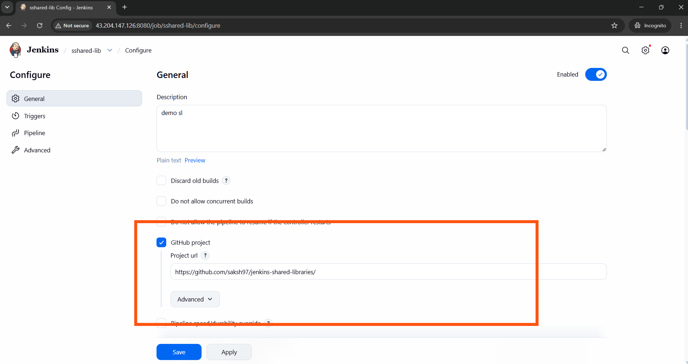
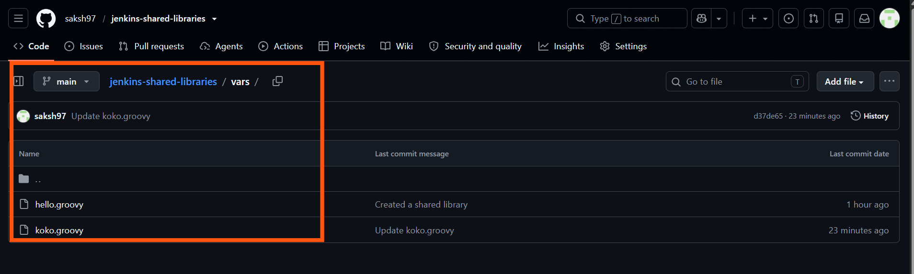
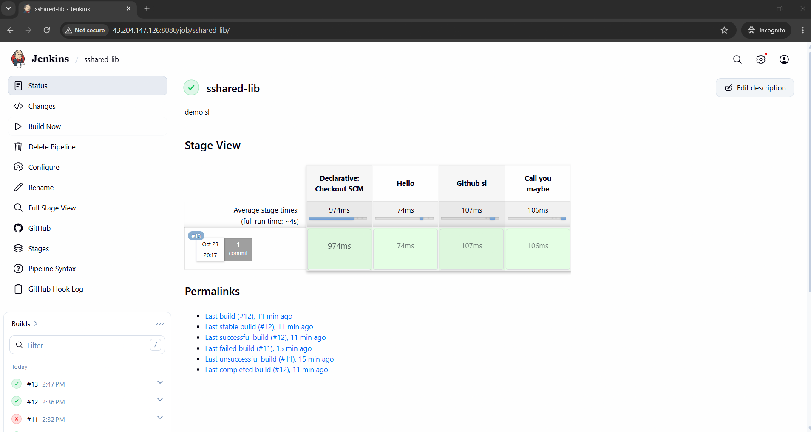

# Jenkins Global Trusted Shared Library Setup & Execution

This document details the configuration, implementation, and successful integration of our Jenkins Shared Library. Centralizing this pipeline logic allows multiple application repositories to safely reuse standardized build workflows.

---

## 1. Global System Configuration
To make custom pipeline steps available globally, the library must be registered within the Jenkins system configuration. The following setup defines the library name, specifies the source code repository (GitHub), and establishes standard retrieval versions like the main branch.

---

## 2. Shared Library Code Structure
The library relies on a structured layout using global variables. Inside the `vars/` directory of the library repository, standard Groovy scripts define modular steps, environment injections, and pipeline arguments that developers can invoke.

---

## 3. Invoking the Library in a Jenkinsfile
Applications pull the shared logic directly into their source control by declaring the library at the very beginning of their deployment script. Using the `@Library` annotation, the pipeline safely imports the trusted steps into its runtime context.

---

## 4. Successful Trusted Pipeline Execution
When the pipeline triggers, Jenkins fetches the trusted code, securely evaluates the functions, and executes the stages without throwing permission exceptions. The screenshot below verifies a clean, completed run using the global library definitions.

---

## 🔍 Execution Verification
For deeper step-by-step diagnostic information regarding the internal lifecycle hooks, Groovy compilations, and exact console printouts during this run, refer directly to the raw log file:

* **[Console Output.txt](./Console%20Output.txt)**
